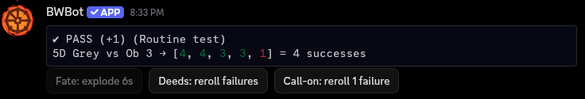

# BWBot

A Discord dice bot for Burning Wheel Gold Revised. It rolls a dice pool, counts successes by shade, compares them to an obstacle, and lets the roller spend Fate, Deeds or a call-on trait after the roll with buttons.

**[Add BWBot to your server](https://discord.com/oauth2/authorize?client_id=1565666581235638372)**

## Using the bot

```txt
/roll dice:5 ob:3 shade:grey open:false
```

| Option | Required | Values | Default |
| --- | --- | --- | --- |
| `dice` | Yes | 1-30, including help, FoRKs, advantage and Persona | |
| `ob` | No | 0-30. Ob 0 just reports successes | 0 |
| `shade` | No | Black (4+), Grey (3+), White (2+) | Black |
| `open` | No | `true` makes 6s explode | `false` |
| `beginners-luck` | No | `true` doubles the Ob and shows what the test counts toward | `false` |
| `disadvantage` | No | 0-30, added to the Ob and not doubled by Beginner's Luck | 0 |

On a Beginner's Luck roll, enter the Ob before doubling. The test is judged on the Ob before doubling plus any disadvantage: Routine counts toward learning the skill, and Difficult or Challenging counts toward the root stat.

Example result:



Successful dice are bold. An exploded 6 shows as `6!`. The test label comes from the book's advancement table, which stops at 18D, so larger pools have no label.

### Spending after the roll

Each button works once per roll, and only for the person who rolled.

| Button | Effect |
| --- | --- |
| Fate | Explodes the 6s. On an open-ended roll, rerolls one failed die instead |
| Deeds | Rerolls all failed dice |
| Call-on | Rerolls one failed die |

Rerolled 6s explode if the roll started open-ended, or after Fate has opened it.

### Die of Fate

`/roll-dof` rolls one die for the Die of Fate and shows the face, using the server's dice emojis if it has them.

### Server settings

These commands need the Manage Server permission by default. You can change who can use them in **Server Settings > Integrations**.

| Command | Effect |
| --- | --- |
| `/roll-settings dice-emojis emojis:<six emojis>` | Shows dice as these emojis, in order for faces 1 to 6 |
| `/roll-settings delete` | Deletes this server's settings, so rolls show numbers again |

Use emojis from the same server, separated by spaces. Emojis can't show which dice succeeded, so draw that into the art if you want it. Changes can take up to a minute to apply. Very long rolls fall back to numbers to fit Discord's message limit.

## Host your own

The bot runs on Cloudflare Workers, and the free tier is enough. You need Node.js 24 or newer, a Discord account and a Cloudflare account. Setup takes about 40 minutes.

1. Clone the repo and install dependencies:

   ```bash
   git clone https://github.com/yigitlevent/burning-wheel-bot.git
   cd burning-wheel-bot
   npm install
   ```

2. Copy `.dev.vars.example` to `.dev.vars`.
3. Follow [DEPLOY.md](DEPLOY.md). It covers the Discord app, Cloudflare, deploying, testing and automatic deploys from GitHub Actions.

Your copy needs its own Discord app and its own Terms of Service and Privacy Policy links. If you change how the bot handles data, update [PRIVACY.md](PRIVACY.md) in your copy too.

## Development

| Command | What it does |
| --- | --- |
| `npm test` | Runs the tests in `.tests/` |
| `npm run typecheck` | Checks types |
| `npm run lint` | Runs ESLint |
| `npm run preview -- 8 4 W true` | Prints a sample roll: dice, Ob, shade, open-ended |
| `npm run dev` | Runs the Worker locally |
| `npm run deploy` | Deploys to Cloudflare |
| `npm run register` | Registers the slash commands with Discord |

## License

[MIT](LICENSE). See also the [Terms of Service](TERMS.md) and [Privacy Policy](PRIVACY.md).
